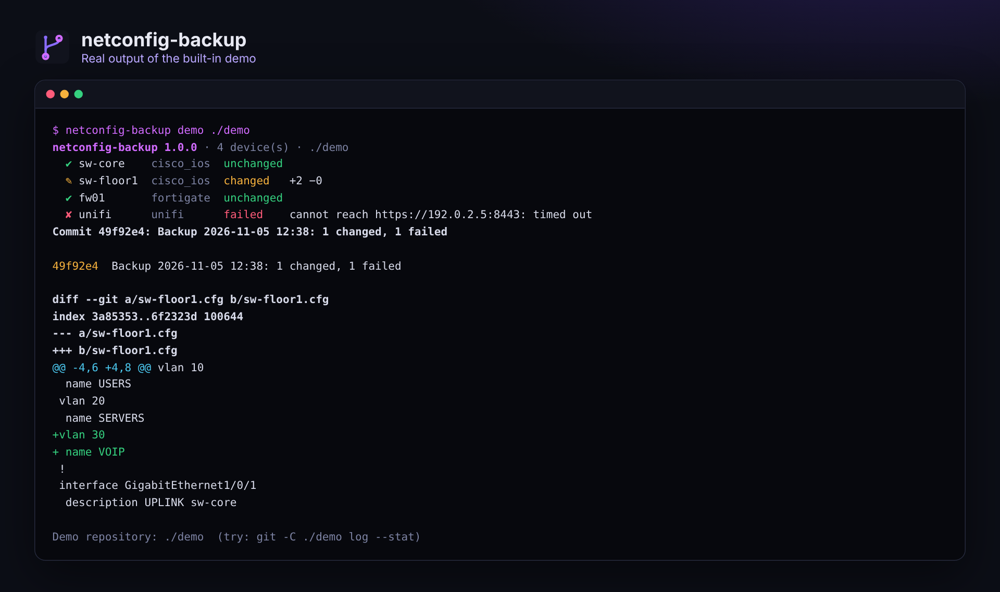

<div align="center">


# netconfig-backup

### Les configurations de ton réseau, versionnées dans Git. Chaque nuit, chaque changement.

**Cisco, FortiGate, UniFi et tout équipement SSH. Un fichier par équipement, un commit par changement,<br>les secrets masqués, et un message quand quelque chose a changé ou échoué.**

[](https://github.com/B2ZO0/netconfig-backup/actions/workflows/ci.yml)
[](LICENSE)


[English](README.md) · **Français**



</div>

---

## Pourquoi ?

« Qui a modifié le switch la semaine dernière, et qu'est-ce qu'il y avait avant ? » Sans sauvegarde, personne ne sait. Les gros outils comme Oxidized ou RANCID répondent à ça, mais demandent un après-midi d'installation. `netconfig-backup` est un seul paquet Python, sans dépendance obligatoire : tu écris un petit fichier avec la liste de tes équipements, tu lances une commande, et tu obtiens un dépôt Git avec tout l'historique de chaque configuration.

## ✨ Fonctionnalités

- 🔌 **Cisco IOS / IOS-XE** en SSH, **FortiGate** par l'API REST (jeton en lecture seule), **UniFi Network** par l'API du contrôleur (contrôleur classique ou UniFi OS), et **tout équipement SSH** avec la commande de ton choix (MikroTik, HP/Aruba, Linux…).
- 🗂️ **Un fichier par équipement, un commit par changement.** Un passage sans vrai changement ne crée pas de commit : l'historique ne montre que ce qui compte.
- 🧹 **Pas de faux changements.** Les lignes qui bougent à chaque export (horodatages, compteurs, secrets FortiGate re-salés, durées de fonctionnement UniFi) sont retirées ou masquées avant la comparaison.
- 🔒 **Secrets masqués dans Git** : secrets Cisco et communautés SNMP, valeurs `ENC` du FortiGate, phrases de passe UniFi. Besoin d'une copie restaurable ? `raw_dir` garde des copies complètes hors de Git, privées (`chmod 600`), avec un nombre de copies à conserver.
- 🔑 **Aucun mot de passe dans le fichier de configuration** : `password_env` et `token_env` les lisent dans des variables d'environnement.
- 🔔 **Notifications** sur Telegram ou n'importe quel webhook (Discord, Slack, Mattermost) quand quelque chose a changé ou échoué.
- ⚡ **En parallèle**, et un équipement en échec n'arrête jamais les autres. Code de sortie `2` quand un équipement a échoué, pour ta supervision.

## 🚀 Démarrage rapide

```bash
git clone https://github.com/B2ZO0/netconfig-backup.git
cd netconfig-backup
python3 -m venv .venv && . .venv/bin/activate
pip install ".[ssh]"            # paramiko n'est nécessaire que pour les équipements SSH

netconfig-backup demo ./demo    # réseau simulé avec un vrai historique Git
```

Puis pour ton réseau :

```bash
cp devices.example.toml devices.toml      # liste tes équipements
export NETBACKUP_SWITCH_PASSWORD='...'    # les secrets viennent de l'environnement
netconfig-backup test                     # chaque équipement répond-il ?
netconfig-backup run                      # sauvegarder et commiter
netconfig-backup history sw-core          # les commits qui ont touché sw-core
netconfig-backup show HEAD sw-core        # ce qui a changé
```

### Une liste d'équipements

```toml
[backup]
repo = "backups"

[defaults]
username = "backup"

[[device]]
name = "sw-core"
type = "cisco_ios"
host = "192.0.2.1"
password_env = "NETBACKUP_SWITCH_PASSWORD"

[[device]]
name = "fw01"
type = "fortigate"
host = "192.0.2.254"
token_env = "NETBACKUP_FORTIGATE_TOKEN"
verify_tls = false

[[device]]
name = "unifi"
type = "unifi"
host = "192.0.2.5"
port = 8443
password_env = "NETBACKUP_UNIFI_PASSWORD"
```

Chaque option est expliquée dans [`devices.example.toml`](devices.example.toml).

### Des comptes en lecture seule

| Équipement | Quoi créer |
|---|---|
| Cisco | Un compte local dédié (le privilège 15 est nécessaire pour lire toute la running-config), autorisé uniquement depuis le serveur de sauvegarde par une ACL sur les lignes VTY |
| FortiGate | *System > Administrators > REST API Admin* avec un profil **lecture seule** et des *Trusted hosts* limités au serveur de sauvegarde |
| UniFi | Un administrateur local **View Only** |

## ⏰ Chaque nuit

Un service et un timer systemd sont dans [`examples/`](examples/) :

```bash
sudo cp examples/netconfig-backup.service examples/netconfig-backup.timer /etc/systemd/system/
sudo install -m 600 -o netbackup examples/netconfig-backup.env /etc/netconfig-backup.env   # puis modifie-le
sudo systemctl enable --now netconfig-backup.timer
```

Ou avec cron : `15 2 * * * cd /opt/netconfig-backup && .venv/bin/netconfig-backup run`.

Tu veux aussi l'historique sur GitHub ou GitLab ? Ajoute un dépôt distant **privé** au dépôt de sauvegarde et mets `git_push = true`.

## 🧪 Tests

Les tests font de vraies sauvegardes sur un **FortiGate et un contrôleur UniFi simulés** (serveurs HTTP locaux) et sur un **switch Cisco simulé en SSH** (serveur paramiko), puis vérifient l'historique Git : sur Python 3.11, 3.12 et 3.13, à chaque modification.

```bash
python -m unittest discover -v -s tests
```

## ✈️ De la famille NetCockpit

De petits outils ciblés pour les admins, du débutant au pro, par l'auteur de [**NetCockpit**](https://github.com/B2ZO0/netcockpit), le cockpit en direct de toute ton infrastructure.

| Outil | Ce qu'il fait |
|---|---|
| [NetCockpit](https://github.com/B2ZO0/netcockpit) | Topologie en direct, VMware, switchs, alertes et journaux dans un seul cockpit |
| [ad-audit-report](https://github.com/B2ZO0/ad-audit-report) | Bilan de santé de l'Active Directory sur une page HTML |
| [ansible-debian-baseline](https://github.com/B2ZO0/ansible-debian-baseline) | Un serveur Debian prêt pour la production en un playbook |
| [netconfig-backup](https://github.com/B2ZO0/netconfig-backup) | Cet outil : les configurations réseau versionnées dans Git |
| [sysadmin-toolbox](https://github.com/B2ZO0/sysadmin-toolbox) | Les outils PowerShell du quotidien pour les admins Windows |
| [proxmox-lab-terraform](https://github.com/B2ZO0/proxmox-lab-terraform) | Un lab de test complet sur Proxmox en une commande |

## 🤝 Contribuer

Un autre type d'équipement (Aruba CX, Juniper, pfSense…) ? [Ouvre un ticket](https://github.com/B2ZO0/netconfig-backup/issues) avec un exemple de sa sortie de configuration. Les pull requests sont les bienvenues.

Si cet outil t'a fait gagner du temps, une ⭐ aide d'autres admins à le trouver.

---

<sub>Fait par [Enzo Marechal](https://enzomarechal.fr) ([@B2ZO0](https://github.com/B2ZO0)), administrateur système et réseau junior. Licence MIT.</sub>
