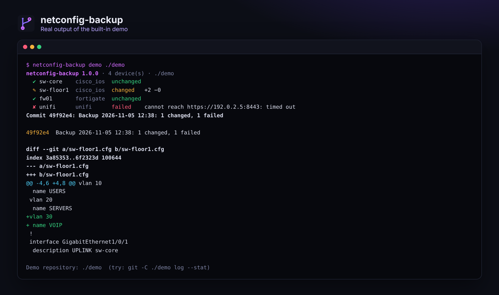

<div align="center">


# netconfig-backup

### Your network configurations, versioned in Git. Every night, every change.

**Cisco, FortiGate, UniFi and any SSH device. One file per device, one commit per change,<br>secrets masked, and a message when something changed or failed.**

[](https://github.com/B2ZO0/netconfig-backup/actions/workflows/ci.yml)
[](LICENSE)


[](https://github.com/B2ZO0/netconfig-backup/stargazers)

**English** · [Français](README.fr.md)



</div>

---

## Why?

"Who changed the switch last week, and what was it before?" Without backups, nobody knows. Big tools like Oxidized or RANCID answer that, but they take an afternoon to set up. `netconfig-backup` is a single Python package with no required dependency: write a small file listing your devices, run one command, and you get a Git repository with the full history of every configuration.

## ✨ Features

- 🔌 **Cisco IOS / IOS-XE** over SSH, **FortiGate** over the REST API (read-only token), **UniFi Network** over the controller API (classic controller or UniFi OS), and **any SSH device** with the command you choose (MikroTik, HP/Aruba, Linux…).
- 🗂️ **One file per device, one commit per change.** A run with no real change makes no commit, so the history only shows what matters.
- 🧹 **No fake changes.** Lines that change at every export (timestamps, counters, FortiGate's re-salted secrets, UniFi uptimes) are removed or masked before comparing.
- 🔒 **Secrets masked in Git**: Cisco secrets and SNMP communities, FortiGate `ENC` values, UniFi passphrases. Need a restorable copy? `raw_dir` keeps full copies outside Git, private (`chmod 600`), with a retention count.
- 🔑 **No password in the config file**: `password_env` and `token_env` read them from environment variables.
- 🛡️ **SSH host keys are checked**: remembered at the first connection, then a backup is **refused** if a device's key changes (a sign of interception). `host_key = "strict"` only trusts keys you added yourself.
- 🔔 **Notifications** to Telegram or any webhook (Discord, Slack, Mattermost) when something changed or failed.
- ⚡ **Parallel**, and one failing device never stops the others. Exit code `2` when a device failed, for your monitoring.

## 🚀 Quick start

```bash
git clone https://github.com/B2ZO0/netconfig-backup.git
cd netconfig-backup
python3 -m venv .venv && . .venv/bin/activate
pip install ".[ssh]"            # paramiko is only needed for SSH devices

netconfig-backup demo ./demo    # simulated network with a real Git history
```

Then for your network:

```bash
cp devices.example.toml devices.toml      # list your devices
export NETBACKUP_SWITCH_PASSWORD='...'    # secrets come from the environment
netconfig-backup test                     # can every device be reached?
netconfig-backup run                      # back up and commit
netconfig-backup history sw-core          # commits that touched sw-core
netconfig-backup show HEAD sw-core        # what changed
```

### A device list

```toml
[backup]
repo = "backups"

[defaults]
username = "backup"

[[device]]
name = "sw-core"
type = "cisco_ios"
host = "192.0.2.1"
password_env = "NETBACKUP_SWITCH_PASSWORD"

[[device]]
name = "fw01"
type = "fortigate"
host = "192.0.2.254"
token_env = "NETBACKUP_FORTIGATE_TOKEN"
verify_tls = false

[[device]]
name = "unifi"
type = "unifi"
host = "192.0.2.5"
port = 8443
password_env = "NETBACKUP_UNIFI_PASSWORD"
```

Every option is explained in [`devices.example.toml`](devices.example.toml).

### Read-only accounts

| Device | What to create |
|---|---|
| Cisco | A dedicated local account (privilege 15 is needed to read the full running-config), allowed only from the backup server with an ACL on the VTY lines |
| FortiGate | *System > Administrators > REST API Admin* with a **read-only** profile and *Trusted hosts* set to the backup server |
| UniFi | A local **View Only** administrator |

## ⏰ Every night

A systemd service and timer are in [`examples/`](examples/):

```bash
sudo cp examples/netconfig-backup.service examples/netconfig-backup.timer /etc/systemd/system/
sudo install -m 600 -o netbackup examples/netconfig-backup.env /etc/netconfig-backup.env   # then edit it
sudo systemctl enable --now netconfig-backup.timer
```

Or with cron: `15 2 * * * cd /opt/netconfig-backup && .venv/bin/netconfig-backup run`.

Want the history on GitHub or GitLab too? Add a **private** remote to the backup repository and set `git_push = true`.

## 🧪 Tests

The test suite runs real backups against a **simulated FortiGate and UniFi controller** (local HTTP servers) and a **simulated Cisco switch over SSH** (paramiko server), then checks the Git history: on Python 3.11, 3.12 and 3.13 at every push.

```bash
python -m unittest discover -v -s tests
```

## ✈️ Part of the NetCockpit family

Small, focused tools for sysadmins, from beginners to pros, by the author of [**NetCockpit**](https://github.com/B2ZO0/netcockpit), a live cockpit for your whole infrastructure.

| Tool | What it does |
|---|---|
| [NetCockpit](https://github.com/B2ZO0/netcockpit) | Live topology, VMware, switches, alerts and logs in one cockpit |
| [ad-audit-report](https://github.com/B2ZO0/ad-audit-report) | Active Directory health check in one HTML page |
| [ansible-debian-baseline](https://github.com/B2ZO0/ansible-debian-baseline) | A production-ready Debian server in one playbook |
| [netconfig-backup](https://github.com/B2ZO0/netconfig-backup) | This tool: network configurations versioned in Git |
| [sysadmin-toolbox](https://github.com/B2ZO0/sysadmin-toolbox) | Everyday PowerShell tools for Windows admins |
| [proxmox-lab-terraform](https://github.com/B2ZO0/proxmox-lab-terraform) | A complete test lab on Proxmox in one command |

## 🤝 Contributing

Another device type you would like to see (Aruba CX, Juniper, pfSense…)? [Open an issue](https://github.com/B2ZO0/netconfig-backup/issues) with an example of its configuration output. Pull requests are welcome.

If this tool saved you some time, a ⭐ helps other admins find it.

---

<sub>Made by [Enzo Marechal](https://enzomarechal.fr) ([@B2ZO0](https://github.com/B2ZO0)), junior system and network administrator. MIT license.</sub>
